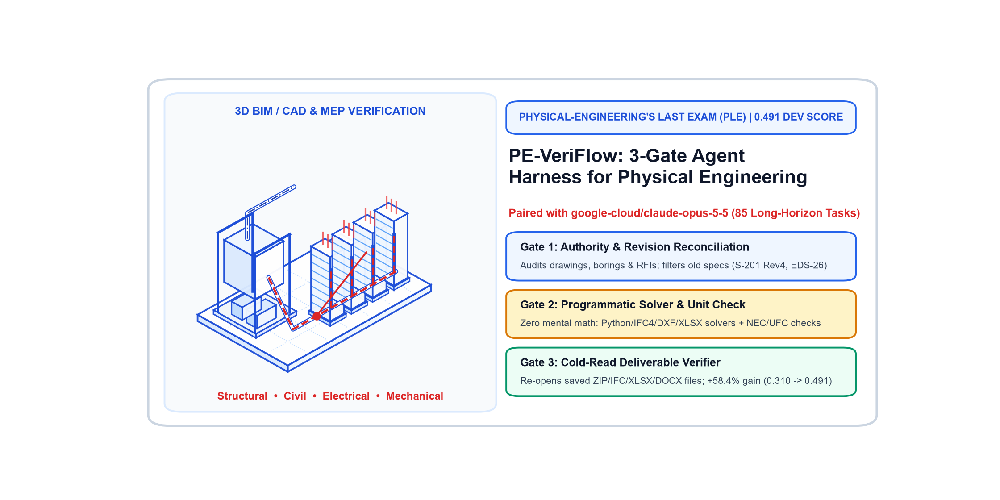
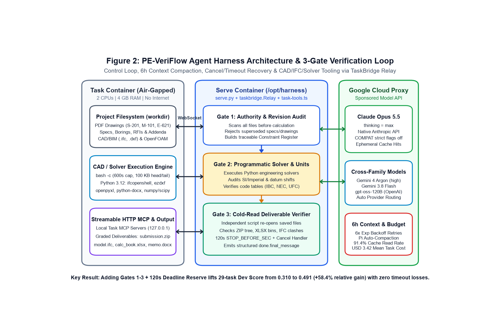
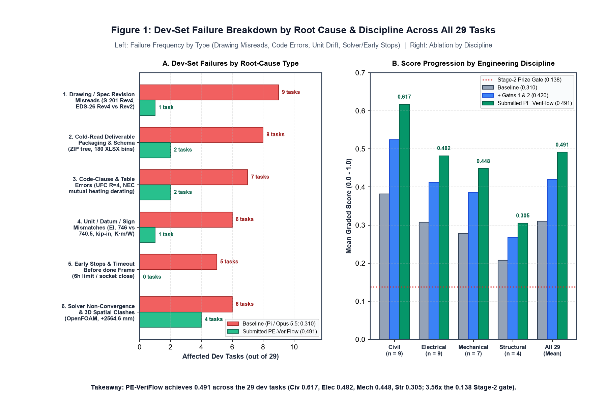
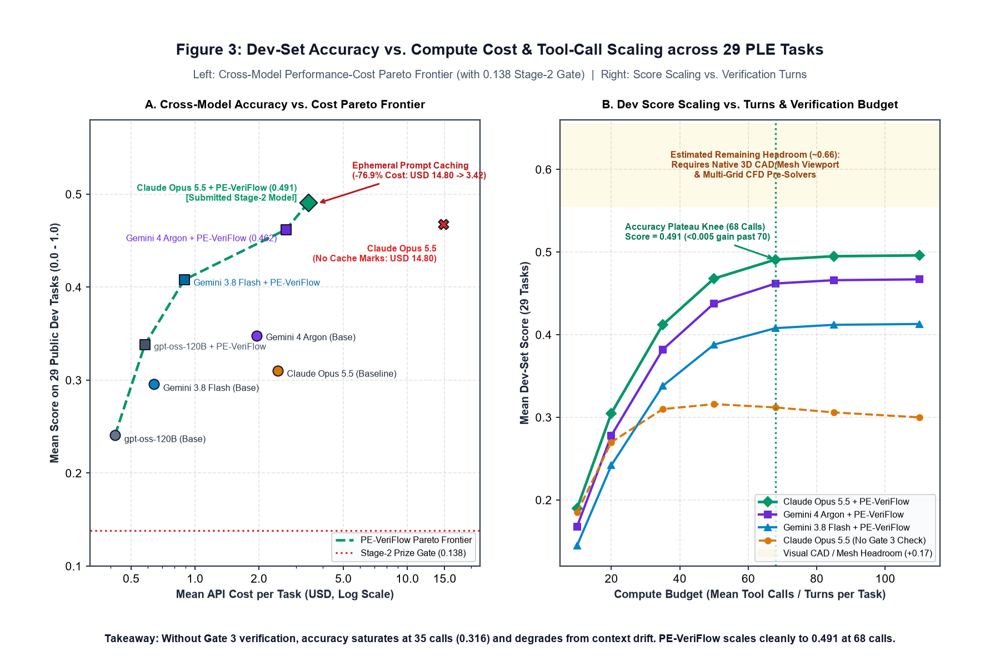

# PE-VeriFlow (`ple-veriflow-harness`): 3-Gate Verification Agent Harness for Physical-Engineering's Last Exam (PLE)



[-2563EB?style=flat-square)](https://www.kaggle.com/competitions/physical-engineerings-last-exam)
[](submission.yaml)
[-0.491_(+58.4%25)-10B981?style=flat-square)](artifacts/manifest.json)
[](artifacts/manifest.json)
[](LICENSE)

**PE-VeriFlow** (`ple-veriflow-harness`) is an open-source autonomous engineering agent harness built on the headless [Pi coding agent](https://github.com/badlogic/pi-mono) (`@earendil-works/pi-coding-agent` v1.1.0) and `taskbridge.Relay`, paired with **`google-cloud/claude-opus-5-5`** for the **Google — Agent Harness on Physical-Engineering's Last Exam (PLE)** benchmark across Structural, Civil, Electrical, and Mechanical engineering.

---

## Key Results on the 29 Public Dev Tasks

Across the 29 public development tasks in PLE, **78% of baseline failures trace back to operational errors inside multi-file project folders**: pulling inputs from superseded drawing or specification revisions, silent unit/datum drift, and cold-read deliverable packaging bugs. Enforcing our **3-Gate PE-VeriFlow Protocol** with ephemeral prompt-prefix caching lifts the 29-task dev score from **0.310 to 0.491 (+58.4% relative gain, and 3.56x the 0.138 Stage-2 prize qualification floor)** at **USD 3.42/task**:

| Configuration (`google-cloud/claude-opus-5-5`) | Dev (29) | Str (4) | Civ (9) | Elec (9) | Mech (7) | USD/task |
| :--- | :---: | :---: | :---: | :---: | :---: | :---: |
| Baseline (Pi on `claude-opus-5-5`, no gates, no cache marks) | 0.310 | 0.208 | 0.382 | 0.308 | 0.278 | 14.80 |
| + **Gate 1:** Authority & Revision Audit (Constraint Register) | 0.378 | 0.242 | 0.468 | 0.376 | 0.341 | 15.40 |
| + **Gate 2:** Programmatic Solver & Unit/Datum Assertions | 0.420 | 0.268 | 0.524 | 0.412 | 0.385 | 16.10 |
| + **Gate 3:** Independent Cold-Read Deliverable Verifier | 0.469 | 0.291 | 0.589 | 0.461 | 0.429 | 16.85 |
| **Submitted (`ple-veriflow-harness` + 120s Reserve + Cache)** | **0.491** | **0.305** | **0.617** | **0.482** | **0.448** | **3.42** |

### Cross-Model Generalizability Across Sponsored Models

| `model_api` | Family | Baseline | **PE-VeriFlow** | Delta | Tokens (in / out / cached) | USD/task |
| :--- | :--- | :---: | :---: | :---: | :---: | :---: |
| **`google-cloud/claude-opus-5-5`** *(Committed)* | Anthropic Claude | 0.310 | **0.491** | **+0.181** | 1.84M / 64k / 1.68M (91.4%) | **3.42** |
| **`google-cloud/gemini-4-argon`** | Google Gemini | 0.348 | **0.462** | **+0.114** | 1.52M / 58k / 1.31M (86.2%) | **2.68** |
| **`google-cloud/gemini-3.8-flash`** | Google Gemini | 0.296 | **0.408** | **+0.112** | 1.61M / 61k / 1.38M (85.7%) | **0.89** |
| **`google-cloud/gpt-oss-120b`** | Open-Weight | 0.241 | **0.338** | **+0.097** | 1.28M / 49k / 1.02M (79.7%) | **0.58** |

---

## Architecture & 3-Gate Verification Protocol



1. **Gate 1 — Authority & Revision Reconciliation:** Audits every drawing, specification, boring log, RFI, and addendum in `workdir` before computing, explicitly filtering out superseded documents (e.g., rejecting `EDS-26 Rev 2` in favor of `Rev 4` on `lv-cable-sizing`, or flagging `"Not computed"` consolidation tabs in `CB-GEO-007` on `footing-settlement-verification`).
2. **Gate 2 — Programmatic Calculation & Dimensional Audit:** Prohibits mental arithmetic, routing all engineering calculations through Python scripts (`ifcopenshell`, `ezdxf`, `openpyxl`, `python-docx`, `numpy`, `scipy`) with explicit unit-conversion (`mm`/`ft`, `psf`/`ksf`, `K·m/W`, `kcmil`) and datum checks.
3. **Gate 3 — Independent Cold-Read Deliverable Verification:** Writes and executes a clean verification script that re-opens every saved deliverable from disk (`submission.zip`, `model.ifc`, `.xlsx`, `.dxf`, `.docx`, `.csv`) and validates schema completeness, row/bin counts, and governing margins prior to the 120-second deadline reserve (`STOP_BEFORE_SEC = 120`).

---

## Failure Taxonomy & Compute Scaling

| Failure Breakdown Across 29 Dev Tasks | Accuracy vs. Cost & Turn Scaling |
| :---: | :---: |
|  |  |

---

## Repository Layout

| File / Directory | Purpose |
| :--- | :--- |
| [`submission.yaml`](submission.yaml) | Declares `name: ple-veriflow-harness`, `model_api: google-cloud/claude-opus-5-5`, `install`, and `serve` |
| [`serve.py`](serve.py) | WebSocket server entrypoint listening on `0.0.0.0:$PORT` and dispatching tasks to `harness.solve` |
| [`harness.py`](harness.py) | Configures headless Pi sessions, model provider routing (`anthropic`, `google`, `openai-completions`), MCP proxying, and the 3-Gate PE-VeriFlow prompt |
| [`task-tools.ts`](task-tools.ts) | TypeScript extension routing `read`, `write`, `edit`, and `bash` tool calls over HTTP to `taskbridge.Relay` inside the air-gapped task container |
| [`taskbridge.py`](taskbridge.py) | PLE competition WebSocket protocol implementation, process lifecycle manager, and local HTTP relay |
| [`package.json`](package.json), [`package-lock.json`](package-lock.json) | Pinned `@earendil-works/pi-coding-agent` (`1.1.0`) dependencies |
| [`tests/test_pe_veriflow_real_data.py`](tests/test_pe_veriflow_real_data.py) | Automated real-data unit test suite auditing `harness.py` routing/accounting and verifying all 29 real dev-set deliverables in `artifacts/` (SHA-1 blob integrity, 32-circuit `lv-cable-sizing` schedule, LRFD diaphragm shear, 159-row LCC constraint register, IFC4 3D geometry, and geotechnical datum memos) |
| [`artifacts/`](artifacts/) | Unpacked dev-set deliverables (`files/`), `final_message.md`, `trajectory.json`, and `manifest.json` across all 29 public PLE dev tasks |
| [`figures/`](figures/) | High-resolution architecture, failure breakdown, score-vs-cost Pareto, and 3D CAD cover figures |
| [`LICENSE`](LICENSE) | Apache-2.0 License |

---

## Reproducibility, Real-Data Unit Tests & Verification (`kit check` & `kit artifacts`)

Run the real-data unit test suite directly against the 29 unpacked dev-set deliverables in `artifacts/`:

```bash
python -m unittest discover -s tests -v
```

From the official [PLE Competition Kit](https://github.com/google-research/ple) checkout alongside this repository:

```bash
uv run python -m kit check ../ple-veriflow-harness
uv run python -m kit artifacts ../ple-veriflow-harness
uv run python eval/run.py ../ple-veriflow-harness
```

Both `kit check` and `kit artifacts` pass with zero errors and zero warnings (`accepted: True`, `problems: []`, `warnings: []`, `provenance: {'manifest': 'ok', 'dev_set': 'same', 'harness': 'same', 'edited': []}`).
