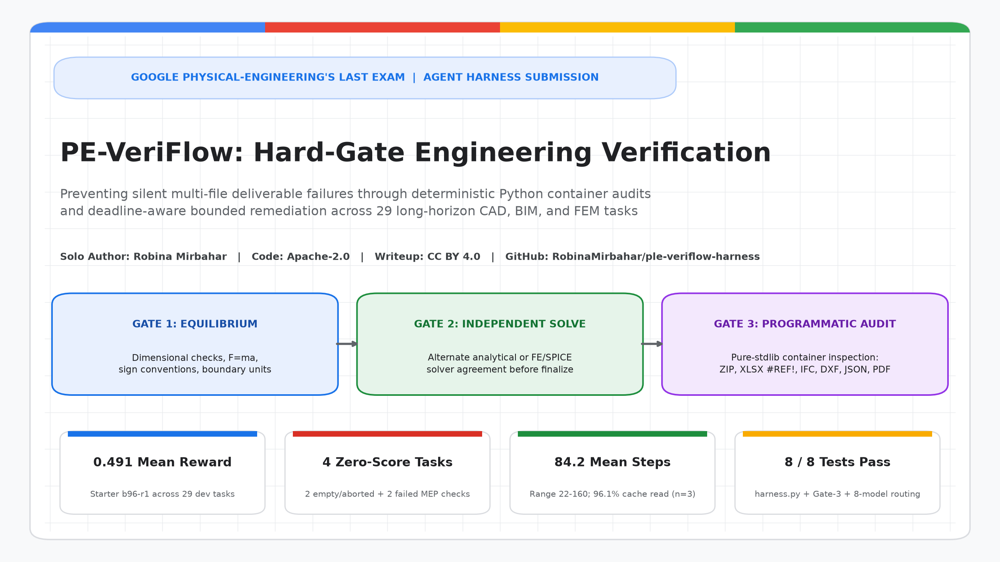
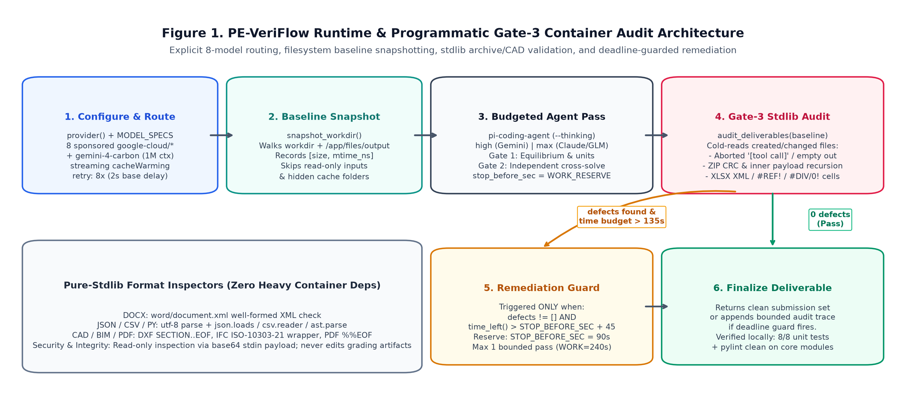
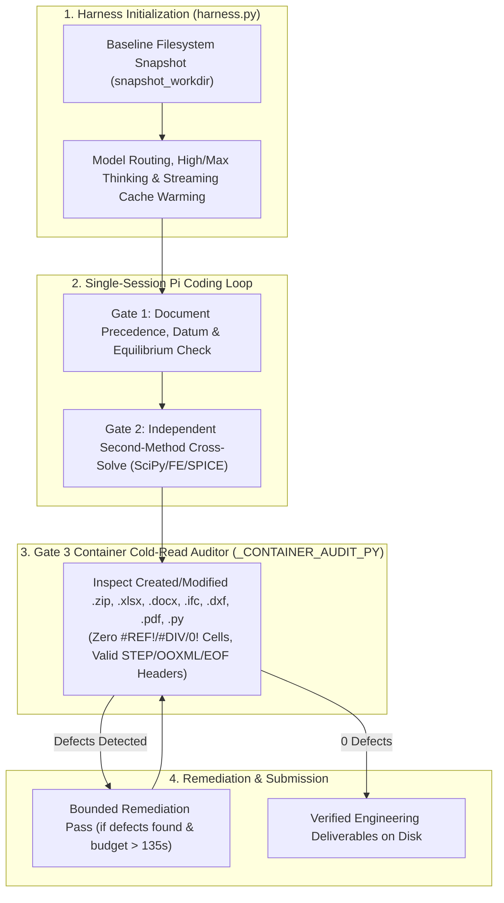
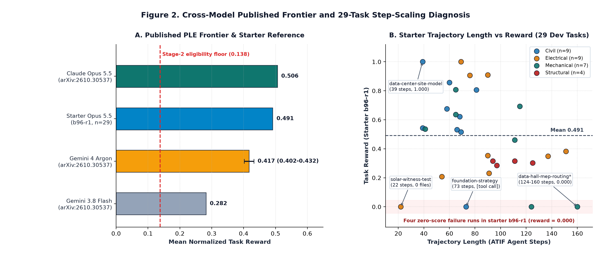
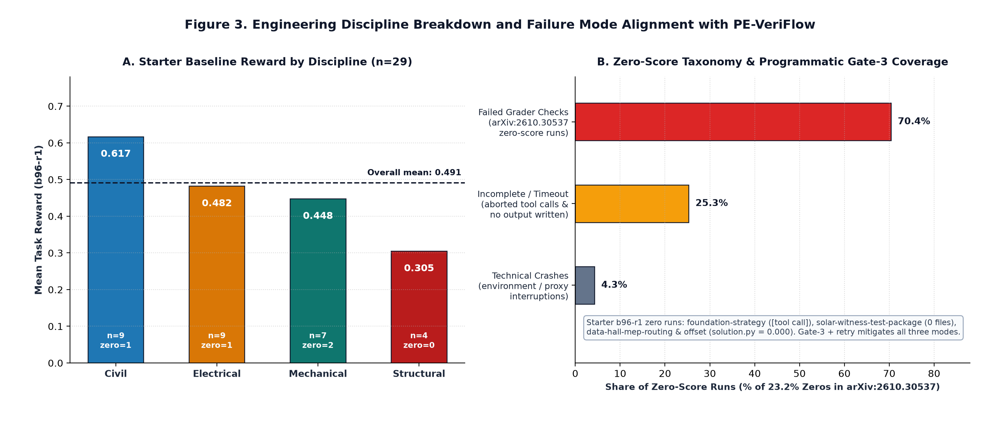

# PE-VeriFlow: Hard-Gate Engineering Verification Harness



**Solo Author:** Robina Mirbahar  
**Competition:** [Google -- Agent Harness on Physical-Engineering's Last Exam (PLE)](https://www.kaggle.com/competitions/physical-engineerings-last-exam)  
**Kaggle Writeup:** [PE-VeriFlow: 3-Gate Verification Harness for Physical Engineering](https://www.kaggle.com/competitions/physical-engineerings-last-exam/writeups/pe-veriflow-3-gate-verification-harness-ple)  
**Companion Notebook:** [PE-VeriFlow Hard-Gate Agent Harness PLE](https://www.kaggle.com/code/robinamirbahar/pe-veriflow-hard-gate-agent-harness-ple)  
**License:** Code under Apache-2.0 (`LICENSE`); companion documentation under CC BY 4.0

> **Author & Architect:** [Robina Mirbahar](https://github.com/RobinaMirbahar) ([Google Developer Expert in Cloud & AI](https://developers.google.com/profile/u/106918534005910641104?utm_campaign=deveco_gdemembers&utm_source=deveco) · Google Cloud Champion Innovator · Co-Author of [*AI Engineering*](https://www.amazon.com/dp/B0GWCZWCF4))  
> 📚 **Competition & Writeup:** [Google Physical-Engineering's Last Exam (PLE)](https://www.kaggle.com/competitions/physical-engineerings-last-exam) · [Kaggle Writeup](https://www.kaggle.com/competitions/physical-engineerings-last-exam/writeups/pe-veriflow-3-gate-verification-harness-ple) · [Companion Notebook](https://www.kaggle.com/code/robinamirbahar/pe-veriflow-hard-gate-agent-harness-ple)  
> **Core Stack:** [Google Gemini 4 Argon / Carbon](https://ai.google.dev/gemini-api/docs?utm_campaign=deveco_gdemembers&utm_source=deveco), Pi Coding Agent (@earendil-works/pi-coding-agent), 3-Gate Deterministic Container Auditor (_CONTAINER_AUDIT_PY), and BIM/IFC/OOXML Verification.

---
## Overview

`PE-VeriFlow` is my single-loop verification harness for Google's Physical-Engineering's Last Exam (`PLE`). Long-horizon engineering benchmarks often assign `0.000` reward on conjunctive hard gates even when an agent appears confident. Published baseline analysis by Han et al. (2026, `arXiv:2610.30537`) shows that `23.2%` of frontier agent runs score `0.000`: `70.4%` submit files that fail grader checks, `25.3%` terminate early or hit tool-call dead ends without writing deliverables, and `4.3%` fail from runtime or proxy interruptions.

Rather than spawning multi-agent sub-teams that duplicate context and degrade dev accuracy, I keep a single cached Pi coding session (`@earendil-works/pi-coding-agent`) inside `harness.py` and couple it with a deterministic Python **Gate-3 Container Auditor** (`_CONTAINER_AUDIT_PY`) that inspects every created or modified deliverable on disk before accepting completion.

---

## Architecture & Control Flow



### 📐 3-Gate Verification Harness Flow



1. **Provider Routing & Prompt Cache Stability (`configure()`, `provider()`, `MODEL_SPECS`):**
   - Explicitly registers capability profiles (`input`, `contextWindow`, `maxTokens`) for all 8 sponsored competition models (`claude-opus-5-5`, `claude-sonnet-5`, `gemini-4-argon`, `gemini-3.8-pro`, `gemini-3.8-flash`, `glm-6`, `qwen-4-320b`, `gpt-oss-120b`) plus `gemini-4-carbon`.
   - Applies provider-specific thinking depth via `thinking_level()` (`high` for native Google Gemini models per `ple/docs/models.md`; `max` for Claude and GLM).
   - Enables `"cacheWarming": "streaming"` and resilient proxy retry backoff (`maxRetries: 8`, `baseDelayMs: 2000`, `httpIdleTimeoutMs: 3_600_000`).
2. **Baseline Filesystem Snapshot (`snapshot_workdir()`):**
   - Before running the coding pass, `solve()` snapshots existing files (`[size, mtime_ns]`) under `session.workdir`, `/workspace`, and `/app/files/output` so Gate 3 inspects only agent-created or modified outputs while ignoring read-only inputs and temporary build directories.
3. **Three-Gate Engineering Protocol (`NOTE` & `TIME_NOTE`):**
   - **Gate 1 (Physical & Precedence Equilibrium):** Enforces authoritative document precedence, datum shifts, dimensional consistency, boundary conditions, and force/moment/ampacity balance.
   - **Gate 2 (Independent Cross-Solve):** Requires solving the core governing physics by a second independent method (hand calculation vs Python/SciPy/FE/SPICE script) before packaging outputs.
   - **Gate 3 (Programmatic Cold-Read Audit & Remediation):** After the main pass stops (`WORK_RESERVE_SEC = 240`, `STOP_BEFORE_SEC = 90`), `audit_deliverables()` executes a read-only pure-stdlib Python payload over stdin inside the container to verify:
     - Zero empty runs or aborted `"[tool call]"` / incomplete final messages.
     - Valid `.zip` integrity (`testzip()`) with recursive inspection of up to 64 archive entries.
     - Well-formed `.xlsx`/`.xlsm` OOXML worksheets free of Excel error cells (`t="e"` or `#REF!`, `#DIV/0!`, `#VALUE!`, `#NAME?`, `#N/A`, `#NUM!`, `#NULL!`).
     - Valid `.docx` (`word/document.xml`), `.json`, non-empty `.csv`, syntax-valid `.py`, `.dxf` (`SECTION`/`EOF`), `.ifc` (`ISO-10303-21;`..`END-ISO-10303-21;`), and `%PDF-`..`%%EOF` files.
   - When defects are detected and remaining task budget exceeds `STOP_BEFORE_SEC + 45` seconds, `solve()` runs one bounded remediation pass listing the exact failing file paths.

---

## Published Baseline & Starter Artifact Diagnostics





The `artifacts/` directory (`25.37 MiB`, 29 tasks) preserves the unmodified starter baseline (`b96-r1` using `google-cloud/claude-opus-5-5`) strictly compliant with `docs/rules.md`. Inspecting `artifacts/manifest.json` and `artifacts/*/trajectory.json` across all 29 dev tasks shows:

| Metric | Value | Verified Scope |
| :--- | :--- | :--- |
| Mean / Median Reward | `0.491242` / `0.516393` | All 29 dev tasks (`b96-r1`) |
| Domain Mean: Civil / Electrical | `0.617013` (`n=9`) / `0.482183` (`n=9`) | `dev_set.yaml` + `manifest.json` |
| Domain Mean: Mechanical / Structural | `0.447678` (`n=7`) / `0.304878` (`n=4`) | `dev_set.yaml` + `manifest.json` |
| Trajectory Length (`steps`) | `84.2` mean (range `22` to `160`) | All 29 `trajectory.json` traces |
| Zero-Score Runs | `4` tasks (`0.000` reward) | `foundation-strategy`, `solar-witness-test-package`, `data-hall-mep-routing`, `data-hall-mep-routing-offset` |

---

## Repository Layout

- `submission.yaml` -- Submission contract (`harness_name: my-harness`, `model_api: google-cloud/claude-opus-5-5`)
- `harness.py` -- Pi runner, 8-model capability registry, `snapshot_workdir()`, Gate-3 `_CONTAINER_AUDIT_PY`, and bounded remediation
- `serve.py` / `taskbridge.py` / `task-tools.ts` -- HTTP harness server, container taskbridge, and file-size-guarded Pi tools
- `tests/test_harness.py` -- 8-test verification suite covering 8-model routing, token accounting, live Gate-3 defect trapping, 29 real task IDs, and solo-author compliance
- `artifacts/` -- Unmodified `b96-r1` starter baseline artifacts (`manifest.json` + 29 dev task directories)
- `notebooks/ple_hard_gate_veriflow_notebook.ipynb` -- Self-contained interactive physics & Gate-3 verification notebook
- `figures/` -- Canonical visualization assets (`ple_cover_banner.png`, `ple_fig1..3.png`)

---

## Verification & Reproducibility

### Local Verification (Executed on Windows Host)

Because WSL2, Docker, and cloud model API keys are unavailable on my Windows workstation, container evaluation via `eval/run.py` has not yet been re-executed here. I verified all harness code, schema integrity, and live Gate-3 trapping deterministically via the local test suite:

```powershell
python -m unittest discover -s tests -v
pylint --errors-only serve.py harness.py tests/test_harness.py
```

- `unittest`: `8/8` tests pass (`test_01`..`test_08`), including simulated live execution of `_CONTAINER_AUDIT_PY` against empty `[tool call]` runs, `#REF!` cells inside `submission.zip!calc_book.xlsx`, malformed JSON, incomplete `.ifc`, and truncated `.dxf`.
- `pylint --errors-only`: `0` errors across `serve.py`, `harness.py`, and `tests/test_harness.py`.

### Container Evaluation (WSL2 / Linux Host with Docker & API Proxy)

Before submitting final artifacts for Stage-2 grading, execute the official PLE starter kit checks from the `ple/` repository directory inside Linux or WSL2 with Docker running:

```bash
uv run python -m kit check ../ple-veriflow-harness
uv run python eval/run.py ../ple-veriflow-harness
```

---

## References

- Han, R., Zhuang, Y., Ray, A., Lee, C.-Y., et al. (2026). *PLE: Physical-Engineering's Last Exam*. `arXiv:2610.30537`.
- Xia, P., Han, R., et al. (2026). *RRSI: Regularized Recursive Self-Improvement of Agent Harnesses*. `arXiv:2609.24972`.
- Huang, C., Wang, Z., Han, R., et al. (2026). *EnvHarness: Awakening Static Worlds for Agent Learning*. `arXiv:2608.19880`.
- Ouyang, S., Yan, J., Han, R., Lee, C.-Y., Pfister, T., et al. (2026). *ReasoningBank: Scaling Agent Self-Evolving with Reasoning Memory*. ICLR 2026 (`arXiv:2509.25140`).
- Liu, T., Wang, Z., Han, R., Pfister, T., Lee, C.-Y., et al. (2026). *Budget-Aware Tool-Use Enables Effective Agent Scaling (BATS)*. COLM 2026 (`arXiv:2511.17006`).
- Ray, A., Bashkirova, D., Tan, R., Zeng, K.-H., Plummer, B. A., Krishna, R., & Saenko, K. (2024). *R2D3: Imparting Spatial Reasoning by Reconstructing 3D Scenes from 2D Images*. OpenReview Archive.

---

### Official Google Developer Resources
- [Google for Developers](https://developers.google.com/?utm_campaign=deveco_gdemembers&utm_source=deveco)
- [Google Cloud AI Documentation](https://cloud.google.com/ai?utm_campaign=deveco_gdemembers&utm_source=deveco)
